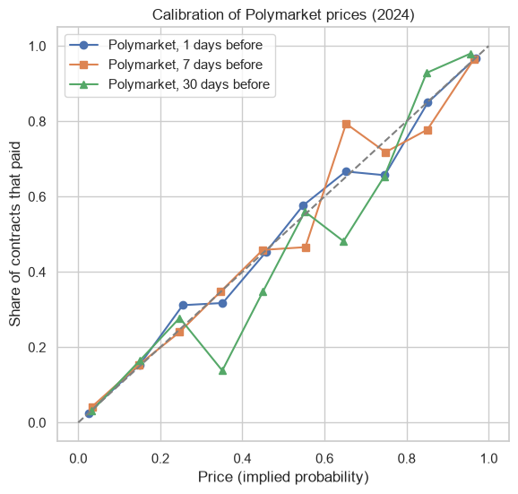
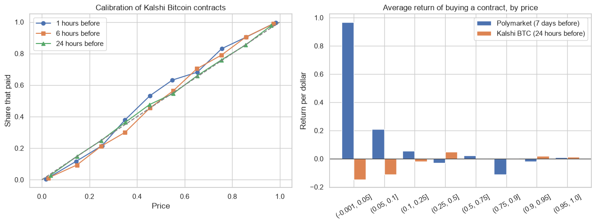

# Are prediction market prices good probabilities? Polymarket and Kalshi

Part of my Graduating Project at Rennes School of Business. If a structured note is hedged with Polymarket or Kalshi contracts, the price of the contract is treated as a probability. This project checks that with thousands of contracts that already resolved:

- **Calibration:** of the contracts that traded at 20 cents, did 20% of them pay?
- **Brier and log scores** at different times before the resolution.
- **Favourite-longshot bias:** the average return of buying contracts at each price (Snowberg and Wolfers, 2010; Page and Clemen, 2013).

**Data:**
- **Polymarket:**
  - All the on-chain fills of January to September 2024: the Envio "Polymarket On-Chain v1" dataset on Hugging Face (CC-BY), aggregated to a daily price per outcome token.
  - The resolution of each market, from the ConditionalTokens contract.
  - Polymarket's website is not available from Colombia, but the on-chain data is public.
- **Kalshi:** hourly bid/ask of the "Bitcoin above K at 5 pm" contracts (KXBTCD), March 2024 to October 2026, from the public API.

## Results
| | Brier score | Constant forecast |
|---|---|---|
| Polymarket, 30 / 7 / 1 days before (same 409 markets) | 0.110 / 0.071 / 0.052 | 0.180 |
| Kalshi Bitcoin, 24 / 6 / 1 hours before | 0.094 / 0.052 / 0.019 | 0.250 |

- **Both markets are well calibrated.** The regression of the outcome on the price has a slope of 0.98 in Polymarket and 1.02 in Kalshi, and neither is significantly different from 1.
- **Favourite-longshot bias:** it shows in the point estimates but it is not significant.
  - Kalshi contracts bought below 5 cents lost 15% on average, and those between 5 and 10 cents lost 11%.
  - The contracts of one day move together. Resampling days, the 95% interval of the return below 10 cents goes from -61% to +51%.
  - In Polymarket the cheapest contracts even paid more than their price, but only because of a few contracts that paid 20 to 50 times. The median return is -100%.
- **Brier and the horizon:** in Polymarket the Brier score looks worse closer to the end when all markets are pooled. That is a composition effect: short-lived markets only exist in the last days. With the same markets at the three horizons, the score improves as expected.




## How to run
```
pip install -r requirements.txt
python collect_polymarket.py     # reads the on-chain fills from Hugging Face with DuckDB (about 500 MB of metadata)
python collect_kalshi_btc.py     # Kalshi, Binance and Deribit data (already saved in data/kalshi_btc)
jupyter notebook calibration.ipynb
```

---
Alejandro Lezcano Osorio | Rennes School of Business (MSc in Financial Data Intelligence) and Universidad EIA
